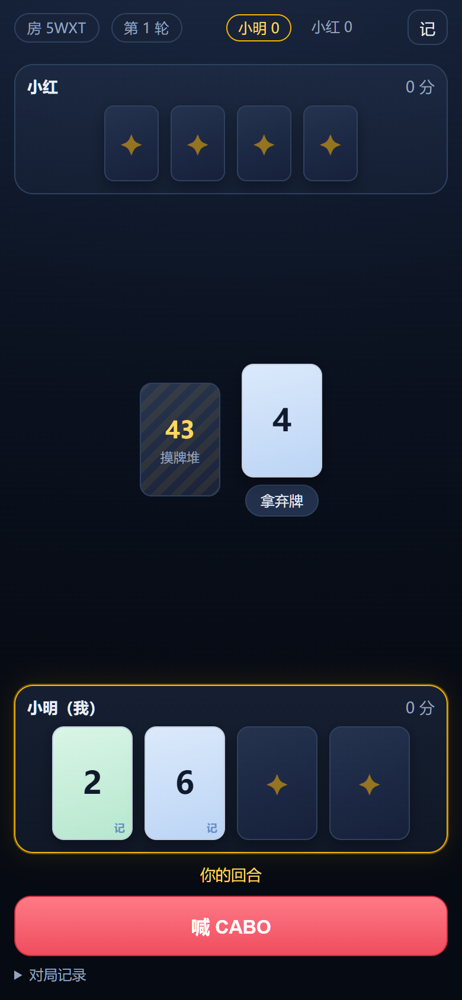
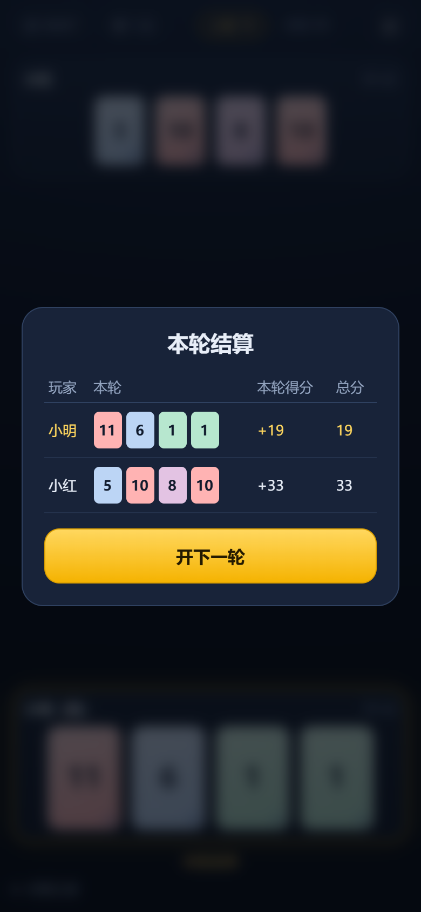

# CABO 卡波 · 双人联机版

手机浏览器直接开打的 CABO（卡波）1v1 联机实现：一个 4 位房间号，两个人，一副 52 张的牌，从看牌、摸牌、用能力到喊 CABO 全流程。

- 前端：React + Vite，深色牌桌、手机竖屏优先，可「添加到主屏幕」当 App 用
- 后端：Node + Express + Socket.IO，内存房间（无需数据库）
- 规则引擎：纯函数，独立单测 + 端到端冒烟测试
- 部署：Render 免费实例（含 `render.yaml`，两三次点击上线）

| 首页 | 牌桌 | 结算 |
| --- | --- | --- |
|  |  |  |

## 本地跑起来

```bash
npm install
npm run dev
# 浏览器打开 http://localhost:5173
```

开两个标签页（一个用无痕窗口）：A 创建房间 → 拿到 4 位房号 → B 输入房号加入 → 房主点「开始游戏」。

常用命令：

| 命令 | 作用 |
| --- | --- |
| `npm run dev` | 同时起后端(8080)和 Vite(5173) |
| `npm test` | 规则引擎单测 |
| `npm run smoke` | 真起服务器，两个 socket 客户端打完整局 |
| `npm run build` | 构建前端到 `dist/client` |
| `npm start` | 生产模式（需先 build），监听 `PORT`，默认 8080 |

## 部署到公网（Render 免费版）

1. 把 `cabo` 整个目录推到一个 GitHub 仓库。
2. 打开 [render.com](https://render.com) 注册（GitHub 登录即可），点 **New → Blueprint**，选这个仓库。
3. Render 会读 `render.yaml` 自动建服务，点 **Apply**，等 2–3 分钟构建完成。
4. 拿到形如 `https://cabo-online-xxxx.onrender.com` 的地址，手机打开即可。
5. iPhone：Safari 分享 → 添加到主屏幕；Android：Chrome 菜单 → 安装应用。

注意：免费实例 **15 分钟没有请求会休眠**，再次访问需要 30–60 秒冷启动。所以开局前先自己打开一次网址「预热」，再把房间号发给朋友。

> 不想用 Render 也可以：任何能跑 Node 20+ 且支持 WebSocket 的平台都行（Railway、Fly.io、自己的小服务器）。服务端只依赖一个环境变量 `PORT`。

## 玩法要点

- 每人 4 张暗牌，开局各自看其中 2 张并记住，之后全凭记忆。
- 回合二选一：
  - **摸牌堆**：抽一张，可以替换自己任意一张（被换下的亮出进弃牌堆），或直接弃掉——若弃掉的是能力牌，触发能力。
  - **拿弃牌堆顶**：必须替换进自己手里，且这张牌之后一直公开。
- 能力牌：`7/8` 看自己一张、`9/10` 偷看对手一张、`11/12` 盲换自己与对手各一张、`13` 看对手一张后可决定交换。
- 觉得自己总点数够小就喊 **CABO**：对手再走一回合后结算。喊的人若是全场最低（并列也算），记 0 分；否则 +10 分，其余人按手牌点数计分。
- 累计分 **超过 100** 时游戏结束，总分最低者胜；恰好 100 分可一次性降到 50 分。
- 完整的规则约定见 [RULES.md](RULES.md)。

## 项目结构

```
cabo/
├─ src/shared/game.ts      纯函数规则引擎（发牌/动作/结算/视角裁剪）
├─ src/client/             React 界面（首页/房间/牌桌）
├─ server/index.ts         Express + Socket.IO，内存房间与重连
├─ scripts/smoke.mjs       端到端冒烟测试
├─ tests/game.test.ts      规则单测
└─ public/                 PWA manifest、图标、Service Worker
```

## 已知取舍

- **没有做「拍牌」**：部分版本的 CABO 允许任何人拍走弃牌堆顶的牌来抢先换牌（拍错有罚分）。这是考反应速度的规则，线下很好玩，线上反而容易变成手速竞赛；如果你确认要，我可以加一个按钮 + 罚分规则。
- 房间只存在内存里：服务器重启/休眠后房间消失，需要重新建房。
- 没有密码与观战：房号即入口，两个人满了就进不来。
- 记牌是全自动的：服务器只把「你自己看过的牌」发给你，前端不需要自己记数据；点右上角「记/盲」可以切换成不显示记忆标记的硬核模式。
